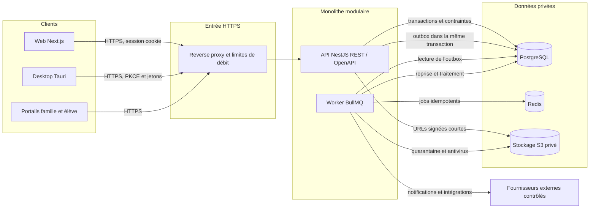

# Décisions d’architecture de lavision

**Version :** 0.2 — 29 octobre 2026

**Référence :** issue #3, jalon M0

**Statut :** architecture acceptée par le représentant produit le 29/10/2026 pour démarrer M1 ; revues techniques, sécurité et exploitation à poursuivre avant clôture de #3 et production

Ces ADR décrivent la cible retenue pour M1. Leur validation produit autorise l’initialisation de l’issue #5, mais ne signale ni une API déjà déployée ni la clôture de l’issue #3. Le frontend et le shell Tauri actuels restent un prototype local jusqu’à leur connexion au socle.

## 1. Index

| ADR | Sujet | Statut |
| --- | --- | --- |
| [ADR-001](ADR-001_MONOLITHE_MODULAIRE.md) | API NestJS en monolithe modulaire et monorepo | Accepté pour M1 |
| [ADR-002](ADR-002_POSTGRESQL_PRISMA.md) | PostgreSQL, Prisma et migrations réversibles | Accepté pour M1 |
| [ADR-003](ADR-003_CONTRATS_OPENAPI.md) | Contrats partagés, validations et OpenAPI | Accepté pour M1 |
| [ADR-004](ADR-004_STOCKAGE_OBJET.md) | Fichiers privés sur stockage S3 compatible | Accepté pour M1 |
| [ADR-005](ADR-005_TACHES_ASYNCHRONES.md) | Worker, outbox et Redis/BullMQ | Accepté pour M1 |
| [ADR-006](ADR-006_AUTHENTIFICATION.md) | Sessions, MFA et authentification desktop | Accepté pour M1 |
| [ADR-007](ADR-007_DESKTOP_TAURI.md) | Distribution et sécurité du desktop Tauri | Accepté pour M1 |
| [ADR-008](ADR-008_ENVIRONNEMENTS.md) | Environnements, déploiement, sauvegardes et retour arrière | Accepté pour M1 |

## 2. Architecture cible retenue pour M1

Les clients n’accèdent jamais directement à PostgreSQL, Redis ou au bucket. L’API applique les permissions et les portées ; le worker applique les mêmes contrats métier et ne reçoit pas de secret inutile dans les charges des jobs.

## 3. Frontières de domaines retenues

- **Identité et accès** : comptes, sessions, MFA, rôles, permissions et portées ;
- **Établissement** : sites, années, périodes, classes et référentiels ;
- **Règles** : configurations versionnées, simulations et snapshots ;
- **Élèves et pédagogie** : admissions, dossiers, programmes, notes, résultats et présences ;
- **Finance** : facturation, caisse, créances et rapports ;
- **Personnel** : dossiers, contrats, congés et paie selon permissions séparées ;
- **Communication et fichiers** : notifications, documents et publications ;
- **Audit** : événements append-only et consultation restreinte.

Un module peut appeler le contrat public d’un autre module. Il ne modifie pas directement les tables internes d’un autre domaine. Les transactions critiques restent locales au monolithe et à PostgreSQL ; aucun microservice n’est créé à ce stade.

## 4. Menaces et réponses architecturales

| Menace | Réponse proposée | Vérification attendue |
| --- | --- | --- |
| Accès horizontal par changement d’identifiant | deny-by-default et portées recalculées côté API | tests SEC-01, SEC-02, SEC-11, SEC-16 et SEC-19 |
| Élévation de privilèges ou auto-approbation | permissions séparées et contrôle du préparateur/validateur | tests SEC-07 à SEC-10 et SEC-20 |
| Vol de session ou de jeton desktop | cookies protégés, rotation, révocation et coffre de l’OS | expiration, révocation et absence de secrets dans les logs |
| CSRF, XSS et contenu distant dans Tauri | protections de session, CSP et allowlist réseau | tests web et desktop sur chaque version |
| Fichier malveillant ou divulgué | bucket privé, quarantaine, antivirus et URLs courtes | téléchargement refusé avant validation et hors portée |
| Double effet après retry | outbox, clés d’idempotence et transactions | arrêt/reprise du worker sans double paiement ni double notification |
| Migration destructive ou rollback impossible | expand/contract, sauvegarde et artefacts précédents | migration et retour arrière répétés sur staging |
| Audit falsifié ou trop détaillé | journal append-only, accès restreint et contenu minimisé | tentative de modification et revue des données journalisées |

## 5. Stratégie de migration et de retour arrière

1. livrer les changements de base en mode **expand**, compatibles avec l’artefact API précédent ;
2. exécuter les migrations Prisma comme une étape contrôlée, après sauvegarde et tests sur une copie anonymisée ;
3. déployer l’API et le worker compatibles avec l’ancien et le nouveau schéma pendant la transition ;
4. effectuer le backfill par lots reprenables, avec contrôle des totaux et sans bloquer les écritures critiques ;
5. supprimer les anciennes colonnes dans une version ultérieure, après stabilisation ;
6. en cas d’échec applicatif, redéployer l’artefact précédent ; en cas d’échec de données, suivre le runbook de restauration plutôt que forcer une migration inverse destructive.

Aucun `migrate reset`, aucune suppression de volume et aucune restauration sur la production ne sont autorisés comme procédure courante. Les objectifs RPO/RTO et la durée de conservation des sauvegardes restent à valider dans OPS-002.

## 6. Validation requise

| Validateur | Attente |
| --- | --- |
| Tech lead | faisabilité, alternatives, limites et coût d’exploitation |
| Représentant métier | adéquation avec les processus et les règles M0 |
| Sécurité/confidentialité | contrôles d’accès, fichiers, sessions et conservation |
| DevOps | staging, sauvegardes, restauration et retour arrière |

Le représentant produit a validé les huit ADR le 29/10/2026 et autorisé le démarrage de #5. L’issue #3 reste ouverte jusqu’aux revues du tech lead, de la sécurité et de DevOps, ainsi qu’aux preuves de mise en œuvre. Les fournisseurs, RPO/RTO et durées de conservation restent des décisions de production séparées.
